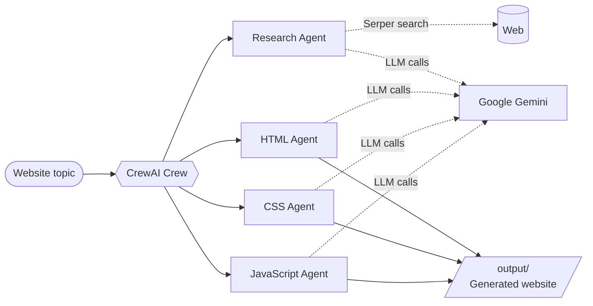

<div align="center">

# 🤖 AI Agent Website Builder

### A team of specialized AI agents that researches, designs, and codes a complete website from a single topic.

[](https://www.python.org/)
[](https://www.crewai.com/)
[](https://ai.google.dev/)
[](https://serper.dev/)
[](#-license)

[Features](#-features) · [How It Works](#-how-it-works) · [Quick Start](#-quick-start) · [Usage](#-usage) · [Configuration](#-configuration) · [FAQ](#-faq) · [Author](#-author)

</div>

---

## 📖 Overview

**AI Agent Website Builder** uses [CrewAI](https://www.crewai.com/) to coordinate multiple specialized agents that work together like a small web team. Give it a topic, and the crew researches it, then writes the HTML, CSS, and JavaScript for a complete website. The language model behind the agents is **Google Gemini**, and web research is powered by **Serper**.

---

## ✨ Features

| Feature | Description |
| --- | --- |
| 🤝 **Multi-Agent Collaboration** | Specialized agents for research, HTML, CSS, and JavaScript work together on one site. |
| 🔎 **Web Research** | Agents search the web (Serper) to ground the content in real information. |
| ⚙️ **Config-Driven Agents & Tasks** | Agent roles and task definitions live in configuration files, so behavior is easy to tune without touching code. |
| 📁 **File Management Utilities** | Generated pages are written to the `output/` folder. |
| 🛡️ **Validation & Error Handling** | Inputs and agent outputs are validated to fail clearly instead of silently. |
| 🔄 **Train & Replay** | Train the crew over several iterations and replay individual tasks. |
| 🧪 **Dev Tooling** | Black, isort, mypy, flake8, and pytest are set up for development. |

---

## 🧠 How It Works



1. You provide a **topic** for the website.
2. The **crew** assigns work to specialized agents, each driven by its configuration.
3. The **research agent** gathers information from the web.
4. The **HTML, CSS, and JavaScript agents** build the site's structure, styling, and behavior.
5. The finished files are saved to **`output/`**, ready to open in a browser.

---

## 📁 Project Structure

```text
aiagentwebsitebuilder/
├── db/                          # Database files
└── website_builder/             # CrewAI project
    ├── src/
    │   └── website_builder/
    │       ├── config/          # Agent and task configuration
    │       ├── tools/           # Custom tools
    │       ├── utils/           # Utility functions
    │       ├── crew.py          # CrewAI crew definition
    │       └── main.py          # Entry point (run / train / replay / test)
    ├── knowledge/               # Knowledge base
    ├── tests/                   # Test suite
    └── output/                  # Generated websites
```

---

## 📋 Prerequisites

- **Python 3.10+**
- A **Google Gemini API key** — see [Getting a Gemini API key](#-getting-a-gemini-api-key)
- A **Serper API key** — create one at [serper.dev](https://serper.dev/)

---

## 🚀 Quick Start

### 1. Clone the repository

```bash
git clone https://github.com/Chintucharan/aiagentwebsitebuilder.git
cd aiagentwebsitebuilder/website_builder
```

### 2. Create a virtual environment

```bash
python -m venv .venv

# Windows
.venv\Scripts\activate

# macOS / Linux
source .venv/bin/activate
```

### 3. Install the package

```bash
# Basic usage
pip install -e .

# Development (adds the code-quality and testing tools)
pip install -e ".[dev]"
```

### 4. Add your API keys

Create a `.env` file in the project root:

```env
MODEL=gemini/<gemini-model-id>
GOOGLE_GEMINI_API_KEY=your_gemini_api_key
SERPER_API_KEY=your_serper_api_key
```

Replace `<gemini-model-id>` with a currently supported model from [Google's model list](https://ai.google.dev/gemini-api/docs/models).

---

## 💻 Usage

Run all commands from the `website_builder/` project folder.

### Create a website

```bash
python -m website_builder.main run "Your Website Topic"
```

Open the generated files from the `output/` folder in your browser.

### Train the crew

```bash
python -m website_builder.main train 10 training_session.json "Your Website Topic"
```

Arguments: number of iterations, output file name, topic.

### Replay a task

```bash
python -m website_builder.main replay "task_id"
```

### Test the crew

```bash
python -m website_builder.main test 5 "<model-name>" "Your Website Topic"
```

Arguments: number of iterations, model to evaluate with, topic.

---

## ⚙️ Configuration

| Variable | Required | Description |
| --- | --- | --- |
| `MODEL` | ✅ | LLM used by the agents, in `provider/model` format (e.g. `gemini/...`). |
| `GOOGLE_GEMINI_API_KEY` | ✅ | Your Google Gemini API key. |
| `SERPER_API_KEY` | ✅ | Your Serper key for web search. |

Agent roles and task prompts are defined in `src/website_builder/config/`. Edit those files to change how the agents behave.

> ⚠️ **Never commit your `.env` file.** Keep API keys out of version control, and use API key restrictions and quotas in Google Cloud.

### 🔑 Getting a Gemini API key

1. Open the [Google Cloud Console](https://console.cloud.google.com/) and create or select a project.
2. Enable the **Gemini API** for that project.
3. Go to **APIs & Services → Credentials → Create Credentials → API Key**.
4. Copy the key into your `.env` file.
5. Optionally restrict the key and set quotas.

---

## 🛠️ Development

```bash
black .        # format code
isort .        # sort imports
mypy .         # type checking
flake8         # linting
pytest         # run tests
```

---

## ❓ FAQ

**What is CrewAI, and how is it used here?**
CrewAI is a framework for coordinating multiple AI agents. Here it organizes the research, HTML, CSS, and JavaScript agents into one crew that builds a site together.

**What kinds of websites can it create?**
Anything you can describe as a topic: portfolios, landing pages, blogs, and business sites. Output quality depends on the model and on how specific your topic is.

**Do I need to know how to code?**
No. You provide a topic and get working files back. Basic HTML/CSS knowledge helps if you want to customize the result.

**Can I customize the output?**
Yes. Edit the agent and task configuration, edit the generated files in `output/` directly, or use `replay` to re-run a specific task.

**Does it cost money to run?**
The Gemini API and Serper both have free tiers, but limits and pricing change, so check each provider's current pricing page.

---

## 🤝 Contributing

Contributions, issues, and feature requests are welcome.

1. Fork the repository
2. Create a feature branch: `git checkout -b feature/your-feature`
3. Commit your changes: `git commit -m "Add your feature"`
4. Push the branch: `git push origin feature/your-feature`
5. Open a Pull Request

---

## 📄 License

This project is licensed under the **MIT License**. See the `LICENSE` file for details.

---

## 🙏 Acknowledgments

- The [CrewAI](https://www.crewai.com/) team for the multi-agent framework
- Google Cloud and the Gemini API team

---

## 👤 Author

**Gowni Venkat Charan** — B.Tech CSE, Madanapalle Institute of Technology and Science (MITS)

[](https://github.com/Chintucharan)
[](https://www.linkedin.com/in/gowni-venkat-charan-1b06562a8/)

<div align="center">

⭐ If you found this project useful, consider giving it a star!

</div>
